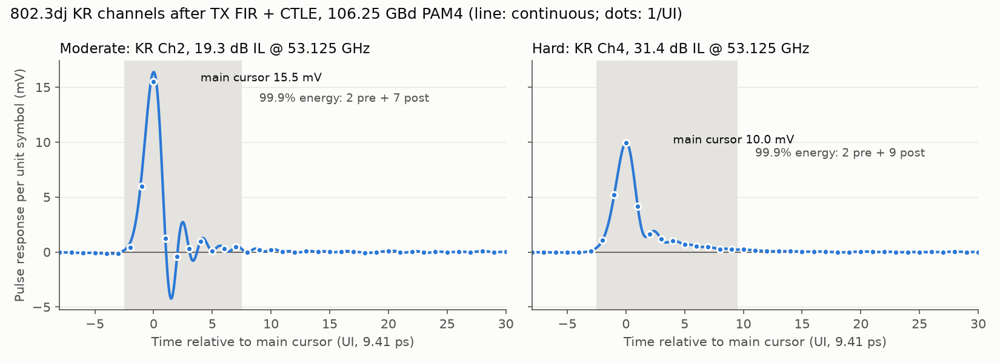
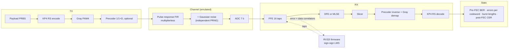
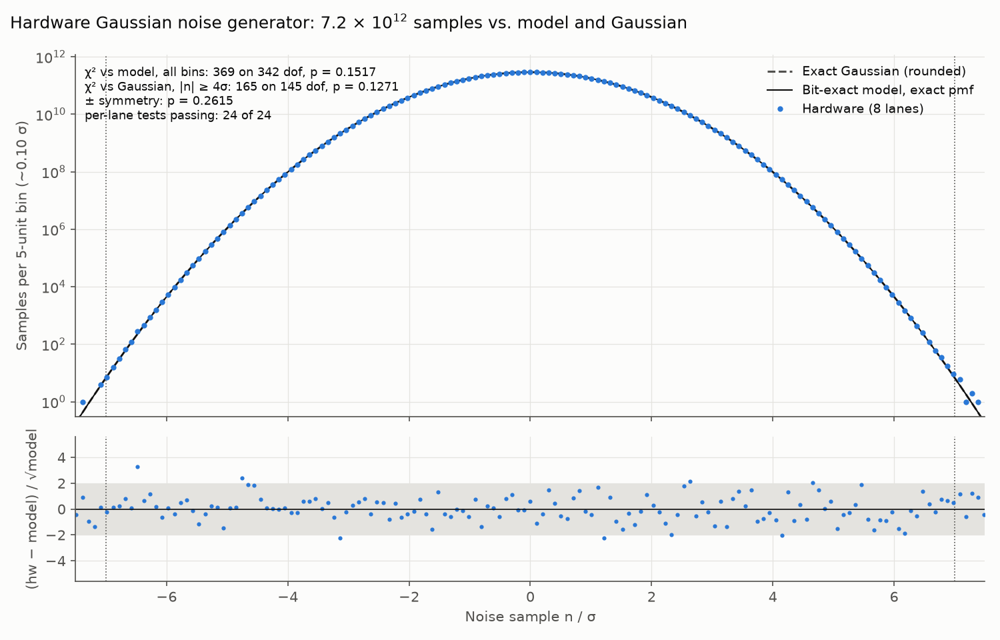
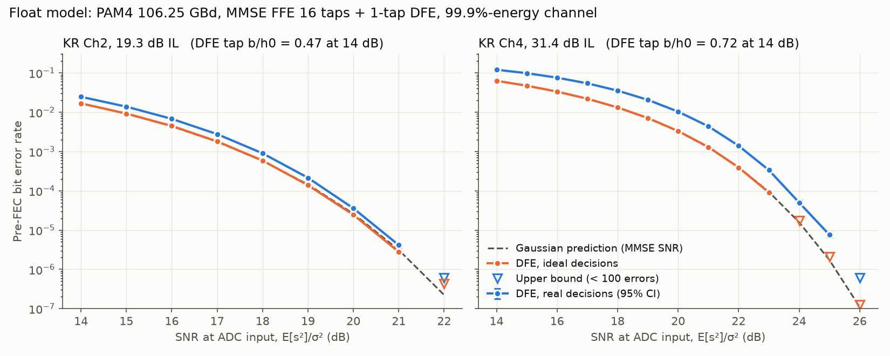
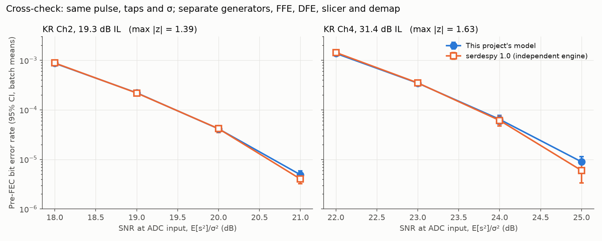
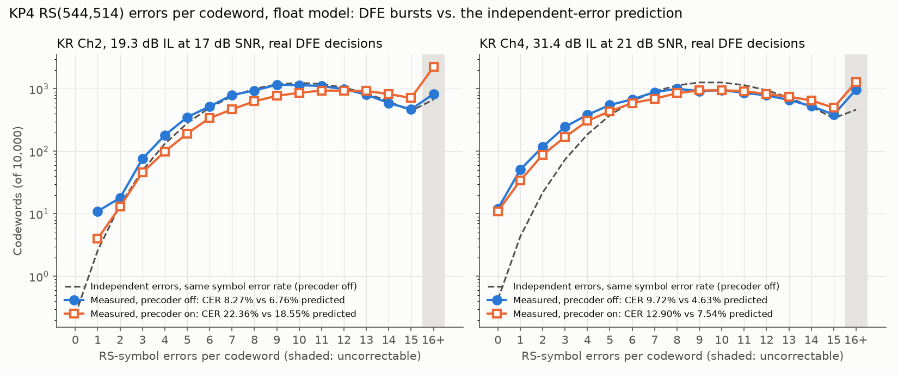
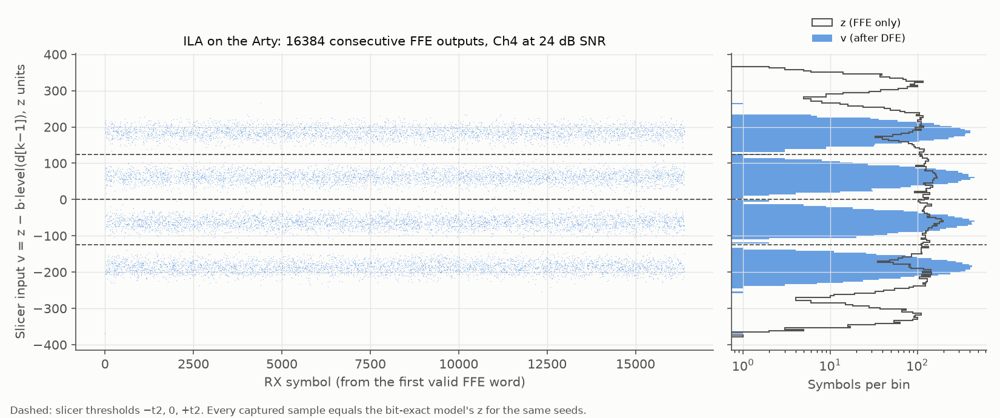
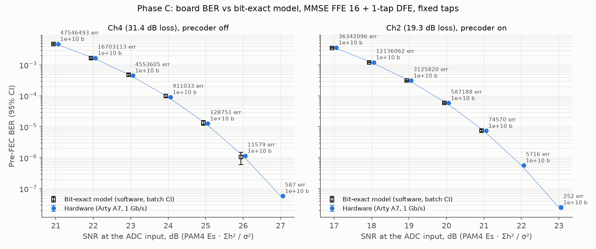

# Open SerDes Lab: a Bit-True FPGA Emulator for 200 Gb/s PAM4 Links and Their Post-FEC Errors

The digital half of a **200 Gb/s-per-lane PAM4 SerDes receiver** (IEEE 802.3dj, 106.25 GBd,
KP4 RS(544,514) FEC), written in SystemVerilog for a Digilent Arty A7-100T. It runs PAM4 symbols
through **real 802.3dj backplane channel data**, an equalizer and the FEC decoder, bit for bit.
It does this fast enough to measure post-FEC error statistics, such as codeword error rates
near 10⁻¹² and burst-length distributions, that software simulation can't reach. The
equalizer's adaptation loop runs as firmware on a RISC-V core
([riscv-rv32i-tmr-core](https://github.com/RodeanAzari/riscv-rv32i-tmr-core)).

**The question it answers:** DFE error propagation turns single errors into bursts, and bursts
interact with Reed–Solomon decoding in ways statistical tools only approximate. The emulator
measures burst lengths, errors per codeword and post-FEC codeword error rate directly, for DFE
vs. MLSE, with and without precoding. It compares them with the prediction for independent errors.

**There is no analog front end.** Everything after the transmitter is emulated digitally: the
channel is a pulse-response FIR, the noise a Gaussian generator, the ADC a quantizer. That is
the design: it makes every run reproducible and every error countable.

**Status: Phase A (Python golden model and sizing) is done (tag `v0.1-model`); no RTL yet.** Every number
below comes from a CSV in [`data/results/`](data/results/) with a sidecar `.md` (command,
commit, tool versions, seeds, interpretation). `[TBD]` means not measured yet.

[](docs/media/2026-11-05_phase-a_pulse-responses.png)

*Symbol-spaced pulse responses of the two 802.3dj backplane channels the emulator runs (TX FIR
and CTLE folded in), from [`make channels`](scripts/make_channels.py). The FPGA channel FIR uses
exactly these taps, scaled to integers.*

## At a glance

| | |
|---|---|
| **Target** | IEEE 802.3dj 200 Gb/s per lane: PAM4, 106.25 GBd, Gray coding, KP4 RS(544,514) over GF(2¹⁰), t = 15 |
| **Channels** | TE 1 m cabled backplane, **19.3 dB** and **31.4 dB** insertion loss at 53.125 GHz; computed IL within 0.05 dB of the published values ([`channels.csv`](data/results/channels.csv)) |
| **Equalizer (planned)** | 16-tap FFE + 1-tap DFE, 4-state MLSE in Phase F; P = 4 symbols per clock, 2 instances ([ADR 0002](docs/decisions/0002-parallelism-and-taps.md)) |
| **Fixed point** | 7-bit ADC at 3.0 × signal rms, 10-bit coefficients and output: **0.60 dB** penalty on the 31.4 dB channel at BER 10⁻¹² (MSE estimate), 0.17 dB at 2.4 × 10⁻⁴ ([`fixed_point_sweep.csv`](data/results/fixed_point_sweep.csv)) |
| **Noise generator** | Segmented inverse CDF, reach 9.155σ; tail probability within **4.5 × 10⁻⁵** (relative) of a Gaussian out to 8σ, computed exactly over all 2⁶³ inputs ([`noise_sweep.csv`](data/results/noise_sweep.csv)) |
| **Noise on hardware** | 8 lanes at 125 MHz: histograms equal the bit-exact model **bin for bin** (0 of 8192 bins differ, 2²² words per lane, 2 seeds) ([`noise_hist_exact.csv`](data/results/noise_hist_exact.csv), [`noise_hist_exact_seed7340033.csv`](data/results/noise_hist_exact_seed7340033.csv)). Tails: **7.2 × 10¹² samples, 27/27 chi-square and symmetry tests pass** (α = 10⁻³ each); 19 samples beyond 7σ, model 19.4, 95% CI 11.4–29.7 ([`noise_hist_stats.csv`](data/results/noise_hist_stats.csv), [`noise_hist_tails.csv`](data/results/noise_hist_tails.csv)) |
| **Model cross-check** | BER agrees with serdespy at 8 of 8 points (\|z\| ≤ 1.63); identical error counts in 80 of 80 paired chunks ([`serdespy_ber.csv`](data/results/serdespy_ber.csv), [`serdespy_paired.csv`](data/results/serdespy_paired.csv)) |
| **KP4 model** | Encoder and decoder agree with the independent `galois` library for 0…15 errors and beyond t ([`model/tests/test_rs.py`](model/tests/test_rs.py)) |
| **DSP budget** | Measured, one link instance: **76 / 240 DSP48E1** (FFE 64, noise 12) ([report](docs/reports/ber_top-5ed0b033/utilization_hier.rpt)); planning estimate for 2 instances ~168 |
| **Emulation speed** | **1 Gb/s** per instance (P = 4 symbols × 125 MHz): 10¹⁰ bits per point in 10 s ([`ber_hw_kr_ch4_31p4db.csv`](data/results/ber_hw_kr_ch4_31p4db.csv)); the software model runs ~7 × 10⁴ b/s |
| **Hardware BER vs. model** | Same seeds: board error counts **equal** the bit-exact model (5149 = 5149 errors over 1,087,424 bits on Ch4; 4002 = 4002 on Ch2 precoded) ([`ber_exact_kr_ch4_31p4db.csv`](data/results/ber_exact_kr_ch4_31p4db.csv), [`ber_exact_kr_ch2_19p3db_pre.csv`](data/results/ber_exact_kr_ch2_19p3db_pre.csv)). Independent seeds: **11 of 11** board points inside the model's 95% batch-means CI, 10⁻³ to 10⁻⁶ ([`ber_model_kr_ch4_31p4db.csv`](data/results/ber_model_kr_ch4_31p4db.csv), [`ber_model_kr_ch2_19p3db_pre.csv`](data/results/ber_model_kr_ch2_19p3db_pre.csv)) |
| **Lowest BER / CER measured** | Hardware pre-FEC BER **2.5 × 10⁻⁸** (252 errors in 10¹⁰ bits, 95% CI 2.2–2.9 × 10⁻⁸ assuming independent errors; 19.3 dB channel, precoder on, 23 dB SNR) ([`ber_hw_kr_ch2_19p3db_pre.csv`](data/results/ber_hw_kr_ch2_19p3db_pre.csv)). CER [TBD] (Phase D). Model: 4.15 × 10⁻⁶ on the 19.3 dB channel at 21 dB SNR, 216 errors ([`model_ber_float.csv`](data/results/model_ber_float.csv)) |
| **Measured vs. predicted CER** | Hardware [TBD] (Phase D). Model, high BER: **2.1×** the independent-error prediction on the 31.4 dB channel at 21 dB (972 codeword errors in 10⁴), 1.22× with 2-way interleaving ([`kp4_model.csv`](data/results/kp4_model.csv)) |
| **Adaptation** | [TBD] (Phase E) |
| **Fmax / LUT / BRAM** | BER board (`ber_top`, one link + UDP): 125 MHz met, WNS +0.360 ns; 8155 LUT, 10575 FF, 7 BRAM tiles ([summary](docs/reports/ber_top-5ed0b033/summary.txt), [utilization](docs/reports/ber_top-5ed0b033/utilization.rpt)) |
| **Tests** | 119 model tests (pytest, `mypy --strict`, ruff); 16 cocotb RTL testbenches against the bit-exact model, with bug injection per block (`make ci`) |
| **Bugs found** | 3, plus 2 analysis findings that changed the design (below) |

## Status

| Phase | Scope | State |
|---|---|---|
| A | Python golden model, channel conversion, sizing | **Done** (2026-11-07, tag `v0.1-model`) |
| B | TX, channel FIR, noise generator, ADC in RTL | **Done** (2026-11-11, tag `v0.2-channel`) |
| C | RX FFE, DFE, slicer with fixed taps; first hardware BER | **Done** (2026-11-11, tag `v0.3-rx`): hardware BER and ILA capture match the model |
| D | KP4 decode on the FPGA + error statistics | Not started; uses `fpga-rs-core` `rs-core-v1.0` (released; [shared blocks](#shared-blocks)) |
| E | Sign-sign LMS adaptation firmware on the [RV32I core](https://github.com/RodeanAzari/riscv-rv32i-tmr-core) | Not started |
| F | MLSE, live dashboard, portfolio | Not started |

Full spec and each phase's definition of done: [docs/buildplan.md](docs/buildplan.md).
Decisions: [docs/decisions/](docs/decisions/). Lab notebook: [docs/log.md](docs/log.md).

## Architecture



Every block is first written in Python ([`model/`](model/)) in the same fixed-point formats as
the RTL ([`docs/fixed-point.md`](docs/fixed-point.md)), so RTL and model can be compared bit for bit.

### Shared blocks

Blocks from sibling projects are consumed only at release tags (git submodules for RTL, pinned
pip packages for Python), never copied.

| Block | Repo | Tag | Used for | State |
|---|---|---|---|---|
| tb-common | [RodeanAzari/tb-common](https://github.com/RodeanAzari/tb-common) | `tb-common-v0.1` | cocotb testbench utilities | Pinned in `requirements.txt`; used by every cocotb testbench |
| fpga-eth-core | [RodeanAzari/fpga-eth-core](https://github.com/RodeanAzari/fpga-eth-core) | `eth-core-v0.2` | UDP stats and sample streaming to the host | Submodule `rtl/eth/`; hardware noise histogram readout (ADR 0009) |
| RV32I SoC | [RodeanAzari/riscv-rv32i-tmr-core](https://github.com/RodeanAzari/riscv-rv32i-tmr-core) | `soc-v1.0` | Core + register bus for the adaptation firmware | Planned, Phase E (`rtl/soc/`) |
| fpga-rs-core | [RodeanAzari/fpga-rs-core](https://github.com/RodeanAzari/fpga-rs-core) | `rs-core-v1.0` | KP4 RS(544,514) decoder | Planned, Phase D (`rtl/rs/`) |

## Verification

**Golden model (now).**

| Layer | What is checked | Reference |
|---|---|---|
| Channel conversion | Computed IL vs. the published table, every `make channels` run | TE contribution |
| Equalizer | MMSE taps are optimal (perturbation test); BER on an ideal channel matches closed form | Closed form |
| Link BER | Statistical agreement and paired bit-identical error counts | serdespy 1.0 |
| KP4 link + statistics | Noise-free chain error-free and RS-aligned; independent errors match binomial CER; decoder agrees with the bounded-distance rule at t = 15/16 | Binomial theory, `model/rs.py` |
| KP4 RS | Encode, decode 0…15 errors, failure detection beyond t | `galois` 0.4.11 |
| Fixed point | Rounding, saturation, slicer ties; integer RX vs. float on identical samples | Float model |
| Precoder | Eqs. 135-1/135-3, worked example, DFE burst → 2 errors, noise-free round trip | IEEE 802.3-2022 135.5.7.2; Broadcom 802.3bj example |
| Noise generator | Exact tail probability to 8σ, symmetry, variance; addressing vs. an independent integer model | Exact Gaussian |

Tests are checked against **injected bugs**: 7 in the RS decoder, 7 in the fixed-point RX, 12
in the noise generator, 6 in the precoder, 9 in the KP4 link and statistics. Each is caught by at least one test before it is reverted.

**Bugs.**
1. *MMSE solver missed the far ISI tail.* A perturbation test found taps with lower MSE than
   the "optimal" solution: the convolution matrix ended too early. Fixed by deriving the
   range from the index bounds.
2. *Factor-2 error in the Gaussian BER prediction* (erfc used in place of Q). Caught on review
   before any run; the ideal-channel test also covers it.
3. *Test time from 16 s to 13 min* with other jobs on the machine: threaded numba kernels in
   `galois` spin-wait under load. The test runner sets `NUMBA_NUM_THREADS=1`.

**Analysis findings that changed the design.**
- The buildplan's noise check (10¹² samples to ±7σ) can only verify to ~6.5σ. 4 × 10¹³ samples
  are needed ([ADR 0003](docs/decisions/0003-noise-generator.md)).
- At 4 × 10¹³ samples, a full-range chi-square against an ideal Gaussian would reject any
  generator that fits the DSP budget, even with bug-free RTL. So the hardware histogram is tested against the
  model's exact distribution, and against the Gaussian only beyond 4σ
  ([ADR 0005](docs/decisions/0005-noise-formats-and-validation.md)).

**RTL (planned):** cocotb with constrained-random stimulus against the model, coverage,
SymbiYosys on small blocks, Verilator lint at zero warnings. [TBD]

## Channel model

Two channels from the TE/Shanbhag 802.3dj KR set: one topology at two host losses, so the
difference between them is loss alone. Each is converted from Touchstone S-parameters to SDD21,
band-limited, filtered and turned into a pulse response at one sample per UI. The TX FIR and
CTLE are chosen by a COM-style search and folded into the taps. Raw files are not committed:
[`data/MANIFEST.md`](data/MANIFEST.md) records source URLs and SHA-256 hashes.

| Choice | Taken | Rejected |
|---|---|---|
| Channel selection | By insertion loss (no published COM for this set) | Computing our own COM: out of scope |
| Sampling phase | Max main cursor: 0.18–0.25 dB from the best phase | COM's Mueller–Müller phase: up to 1.08 dB worse here ([`phase_sweep.csv`](data/results/phase_sweep.csv)) |
| Noise in emulation | White, after the CTLE | Coloured (CTLE-shaped) noise: more fidelity, more FIR |

Details: [ADR 0001](docs/decisions/0001-channel-model.md).

## Noise generator

BER near 10⁻¹² is set by noise ~7σ out, so the generator's tails decide whether a BER is real.
Sum-of-uniforms generators have no tails and give fake-good BER. Here, one 64-bit uniform word
per sample feeds a segmented inverse CDF: the leading-zero count picks an octave (finer toward the tail),
and a degree-2 polynomial per segment evaluates on 3 DSP48E1. The map is a fixed function of
one input, so the model computes the output distribution **exactly**, with no sampling.

| Choice | Taken | Rejected |
|---|---|---|
| Method | Inverse CDF, 1024 segments | Box–Muller (no exact tail check), Ziggurat (variable latency), Wallace (correlated outputs), sum of uniforms (no tails) |
| Hardware check | Histogram vs. exact model pmf; Gaussian chi-square beyond 4σ | Full-range Gaussian chi-square at 4 × 10¹³: fails even with bug-free RTL |



The hardware run was planned at 4 × 10¹³ samples and stopped at 7.2 × 10¹² when the host lost
its link to the board; ±7σ is tested, with ~19 tail samples instead of ~100.

Details: [ADR 0003](docs/decisions/0003-noise-generator.md), [ADR 0005](docs/decisions/0005-noise-formats-and-validation.md).

## Equalizer, KP4 and statistics

Sizing ([ADR 0002](docs/decisions/0002-parallelism-and-taps.md)): the FFE saturates at ~12 taps
and 16 taps is within 0.01 dB of 32 on both channels ([`ffe_sizing.csv`](data/results/ffe_sizing.csv)).
P = 4 symbols per clock lets one `fpga-rs-core` decoder (5 PAM4 symbols per RS symbol) keep up.

DFE error propagation is already visible in the model: with real decisions, BER is ~1.5× the
ideal-decision BER on the 19.3 dB channel and 3.5–4.4× on the 31.4 dB channel
([`model_ber_float.csv`](data/results/model_ber_float.csv)). That gap is the burst mechanism
Phase D measures against KP4.

[](docs/media/2026-11-05_phase-a_model-ber-waterfall.png)

[](docs/media/2026-11-07_phase-a_serdespy-overlay.png)

The end-to-end KP4 model already shows the effect at high pre-FEC BER (10⁻³ range). On the
31.4 dB channel at 21 dB SNR, codewords with more than 15 RS-symbol errors occur 2.1× as often
as independent errors at the same symbol error rate would give: **9.72% (95% CI 9.15–10.32%) vs
4.63%**. 2-way interleaving brings it to 1.22×. With ideal DFE decisions, the measured CER
matches the prediction, which validates the comparison. The 1/(1+D) precoder cuts BER and burst length
there, but **raises** CER (9.7% → 12.9%): short bursts often sit inside one or two RS symbols,
and precoding turns them into entry and exit errors that can land in two. Details and limits:
[`kp4_model.md`](data/results/kp4_model.md).

[](docs/media/2026-11-07_phase-a_kp4-errors-per-codeword.png)

At realistic BER the CER is ~10⁻⁷ or lower, out of the model's reach; measuring it is the job
of the FPGA (Phase D). Adaptation firmware: [TBD] (Phase E).

## On the board, demos, in Vivado

The noise generator runs on the Arty: 8 lanes at 125 MHz into per-lane histograms in BRAM, read
over UDP by `scripts/noise_hist_run.py` ([ADR 0009](docs/decisions/0009-hardware-noise-histogram.md)).
The full emulated link (`ber_top`: TX, channel FIR, noise, ADC, 16-tap FFE, 1-tap DFE, BER
counters) runs on the Arty at 1 Gb/s, controlled over UDP by `scripts/ber_run.py`
([ADR 0012](docs/decisions/0012-ber-board-run-control.md)). A run stops after exactly R bits,
so a short board run is compared with the bit-exact model count for count; long runs give the
waterfall below. Points below ~10⁻⁷ are board-only: the software model would need ~8 h each.

An on-chip logic analyzer (ILA) on the FFE output captures 16384 consecutive equalized samples
from the running link; every one equals the bit-exact model's sample for the same seeds
([`ffe_capture_kr_ch4_31p4db_24db.csv`](data/results/ffe_capture_kr_ch4_31p4db_24db.csv)).
After the DFE feedback the slicer sees four separated levels:

[](docs/media/2026-11-11_phase-c_ila-ffe-eye.png)

[](docs/media/2026-11-11_phase-c_ber-hw-vs-model.png)

## Results

| Result | Value | Source |
|---|---|---|
| Channel IL, computed vs. published | 19.26 / 19.3 dB, 31.38 / 31.4 dB | [`channels.csv`](data/results/channels.csv) |
| FFE length | 16 taps within 0.01 dB of 32 | [`ffe_sizing.csv`](data/results/ffe_sizing.csv) |
| DFE error-propagation BER ratio (float) | 1.5× (19.3 dB), 3.5–4.4× (31.4 dB) | [`model_ber_float.csv`](data/results/model_ber_float.csv) |
| Model vs. serdespy | 8/8 points \|z\| ≤ 1.63; 80/80 paired chunks identical | [`serdespy_ber.csv`](data/results/serdespy_ber.csv), [`serdespy_paired.csv`](data/results/serdespy_paired.csv) |
| Fixed-point penalty, 31.4 dB channel | 0.17 dB at 2.4 × 10⁻⁴, 0.60 dB at 10⁻¹² | [`fixed_point_sweep.csv`](data/results/fixed_point_sweep.csv) |
| Fixed/float BER ratio (real DFE), 31.4 dB channel | 1.22 → 1.81 over +0…2 dB | [`fixed_point_ber.csv`](data/results/fixed_point_ber.csv) |
| Noise tail error to 8σ | 4.5 × 10⁻⁵ relative (exact) | [`noise_sweep.csv`](data/results/noise_sweep.csv) |
| KP4 CER vs. independent prediction (model, 31.4 dB, 21 dB SNR) | 2.1× non-interleaved, 1.22× 2-way; precoder 9.7% → 12.9% | [`kp4_model.csv`](data/results/kp4_model.csv) |
| Hardware BER, same seeds as the model | identical counts (Ch4; Ch2 precoded), ~10⁶ bits each | [`ber_exact_kr_ch4_31p4db.csv`](data/results/ber_exact_kr_ch4_31p4db.csv), [`ber_exact_kr_ch2_19p3db_pre.csv`](data/results/ber_exact_kr_ch2_19p3db_pre.csv) |
| Hardware BER waterfall, 10¹⁰ bits per point | Ch4 4.8 × 10⁻³ … 5.9 × 10⁻⁸ (587 errors); Ch2 precoded 3.6 × 10⁻³ … 2.5 × 10⁻⁸ (252 errors); 11/11 points with a model run inside its 95% batch CI | [`ber_hw_kr_ch4_31p4db.csv`](data/results/ber_hw_kr_ch4_31p4db.csv), [`ber_hw_kr_ch2_19p3db_pre.csv`](data/results/ber_hw_kr_ch2_19p3db_pre.csv) |
| Hardware CER | [TBD] (Phase D) | |

## Limitations

Stated plainly, because they are real:

1. **This is an emulator, not a 106 GBd link.** The symbols are bit-true, but they run at a
   ~1 Gb/s emulation rate. Symbol timing is ideal: no jitter, no CDR.
2. **No package model.** The channel data is TP0–TP5 without the package 802.3dj COM adds.
3. **White noise.** Noise is added after the CTLE without its colouring.
4. **Some reference values are from 802.3ck** (CTLE form, COM noise for CTLE selection), not yet
   checked against the 802.3dj tables ([ADR 0001](docs/decisions/0001-channel-model.md)).
5. **Single lane.** No multi-lane distribution or PCS; codeword interleaving is modelled as an
   assumption (non-interleaved and 2-way), not as a real PMA.
6. **The CTLE, ADC and CDR are not hardware.** They are folded into the pulse response or
   modelled as a quantizer.

## Prior work and novelty

The closest prior work is the University of Toronto FPGA platform for post-FEC BER analysis of
200G links (Barrie, Yang, Shakiba, Carusone, MWSCAS 2024). It counts symbol errors per KP4
codeword but does not run the RS decoder on the FPGA, and no open-source release was found.
serdespy (also U of T) is a Python-only simulator, used here as an independent cross-check.

The goal is the first open-source FPGA emulator, that I'm aware of, that runs KP4 decoding in
hardware against 802.3dj channel data and reports measured against predicted post-FEC error
rates. That claim waits for Phase D.

## Build and reproduce

Requires Python 3.11+ (developed on 3.14.4). Every target works from a clean checkout:

```
make setup        # venv + pinned requirements + submodules
make channels     # download channel archives (hash-checked) → data/channels/*.npz
make model-test   # 71 tests + mypy --strict + ruff
make model-kp4    # KP4 statistics, float model (~30 min)
make model-ber    # float BER waterfall (~3 min)
make xcheck       # serdespy cross-check
make plots        # regenerate every plot in docs/media/ from data/results/
make ci           # what CI runs
```

RTL, synthesis and hardware targets (`sim`, `synth`, `prog`, `ber`) are [TBD].

## Repository layout

```
model/      Python golden model (channel, equalizer, fixed point, noise, precoder, KP4 link + statistics) + tests
scripts/    channel conversion, sweeps, cross-checks → data/results/
analysis/   plots (run by `make plots` only)
data/       channels/ (converted pulses), results/ (CSV + sidecar .md), MANIFEST.md
docs/       buildplan, decisions (ADRs), fixed-point formats, log, media
rtl/ tb/ fw/ syn/   [TBD]
```

## Roadmap

1. Phase B: bit-exact payload PRBS and noise uniform source in the model, then TX, channel
   FIR, noise generator and ADC in RTL, bit-exact against the model; overnight noise histogram
   on the board.
2. Phase C: FFE/DFE with fixed taps; first hardware BER curve over the model.
3. Phase D: KP4 decode with `fpga-rs-core`; errors per codeword and measured vs. predicted CER.
4. Phase E: sign-sign LMS adaptation on the RV32I core.
5. Phase F: MLSE vs. DFE burst comparison, live dashboard, demo video.
